<p align="center"></p>

# DocScan - Smart Document Scanner (Flutter Lab Project)

> **One app, all 20 experiments.** DocScan turns your phone camera into a document scanner:
> capture a page -> extract text with on-device OCR -> save it in a local database -> export a PDF.
> Every experiment of the *Flutter Lab Manual* (Units 1-10) is implemented **inside this app** and can also be launched one by one from the **Lab** tab.

## App Highlights
| Splash (Exp 8a) | Home (Exp 3-6) | Scan (Exp 7) | Detail & PDF (Exp 4a) |
|:--:|:--:|:--:|:--:|
| 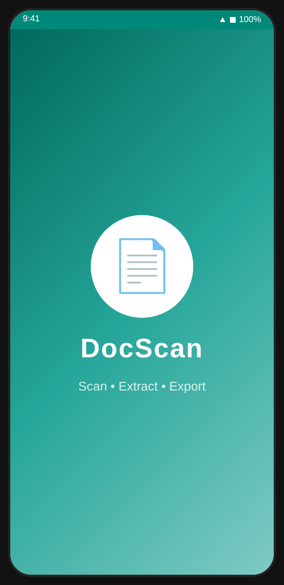 | 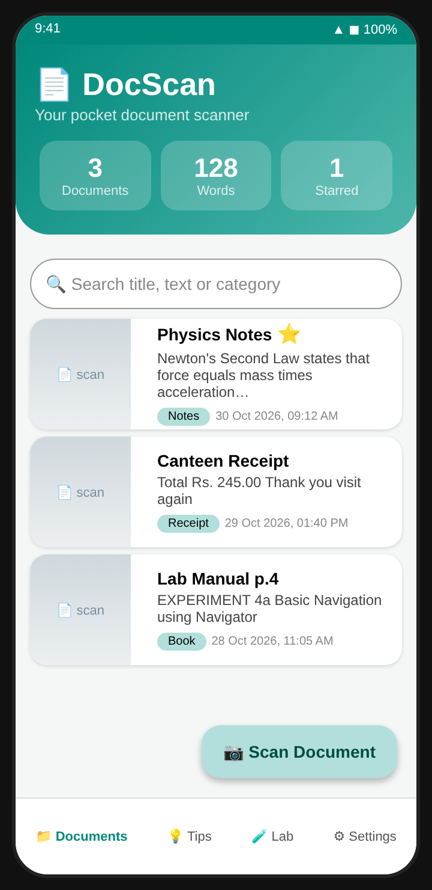 | 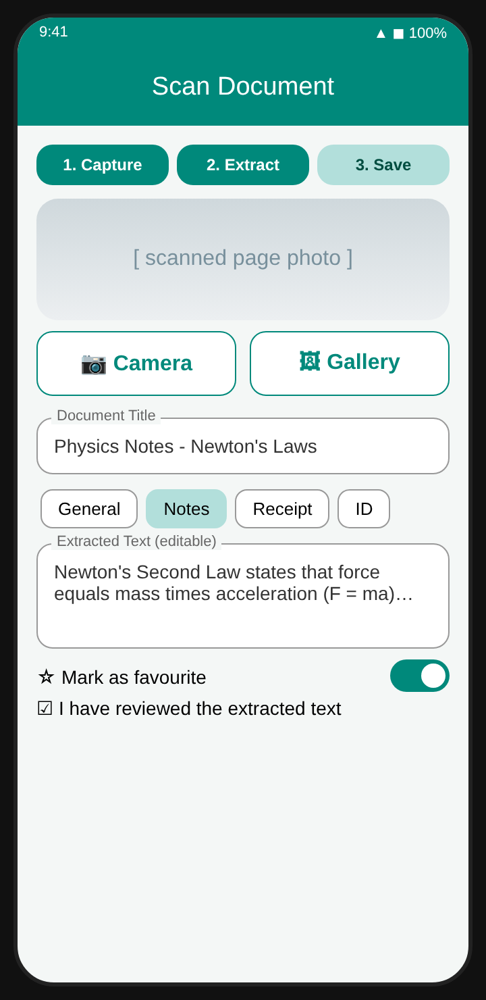 | 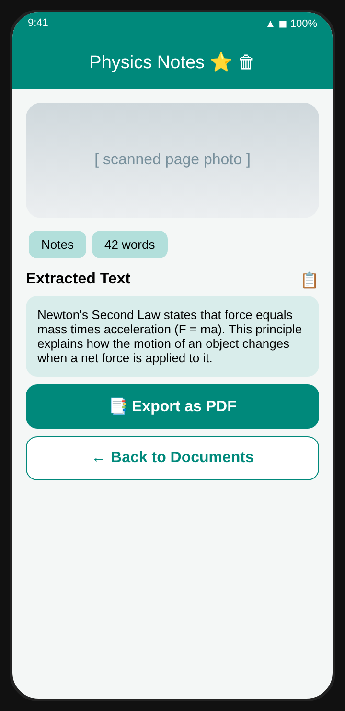 |

| Tips - REST API (Exp 9) | Lab hub (20 experiments) | Settings - Provider + Themes (Exp 5b, 6b) |
|:--:|:--:|:--:|
| 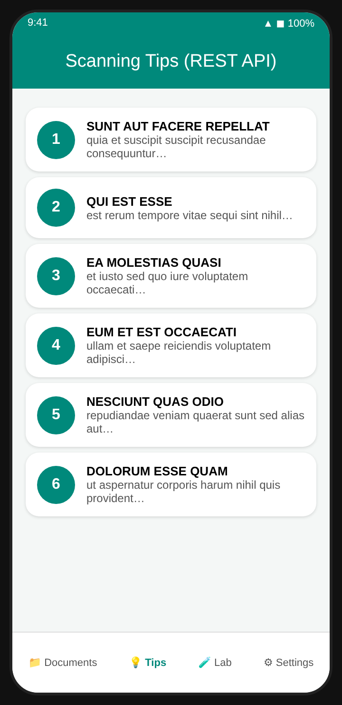 | 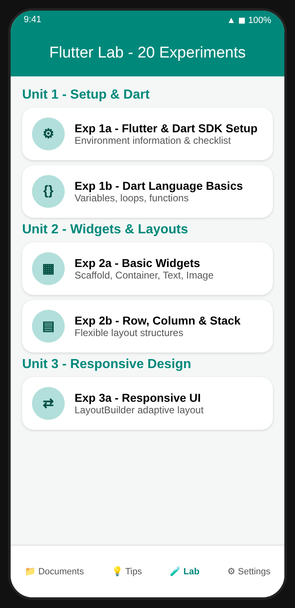 | 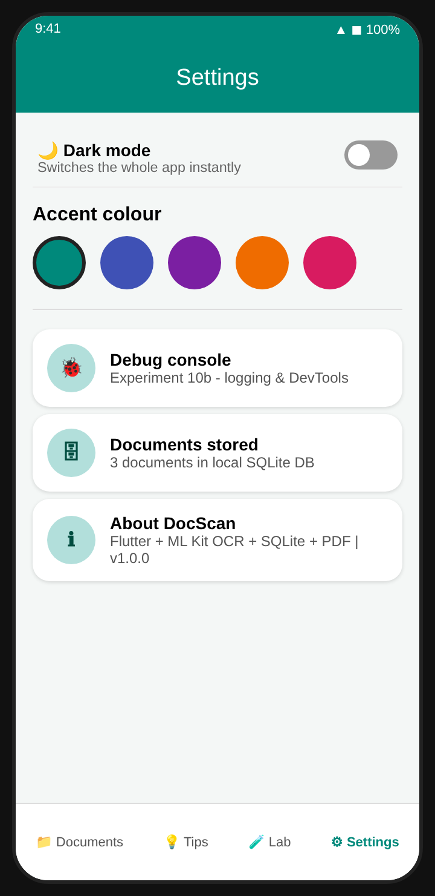 |

**Features:** camera/gallery capture - on-device OCR (Google ML Kit, works offline) - editable text - SQLite storage - categories & favourites - search - PDF export & share - dark mode & accent colours - REST API tips - responsive layout.

---

## How to Run on Your Phone (3 steps)
**Prerequisite:** Flutter SDK installed (see Experiment 1a). Phone with **USB debugging ON** (Settings -> Developer options) connected by USB, *or* an Android emulator running.

1. Open a terminal **inside this folder** (`DocScan_Flutter_Lab`).
2. Run the one-click setup:
   - **Windows:** double-click `setup.bat` (or run `setup.bat`)
   - **macOS / Linux:** `./setup.sh`
3. The app installs and starts on your phone. Next time, just run `flutter run`.

<details><summary>What does the setup script do? (manual commands)</summary>

```bash
flutter create --project-name docscan --platforms=android,ios .   # generates android/ and ios/ folders
dart run tool/patch_platforms.dart                                # adds INTERNET + CAMERA permissions
flutter pub get                                                   # downloads packages
flutter run                                                       # runs on the connected phone
```
Build an installable APK: `flutter build apk --release` -> `build/app/outputs/flutter-apk/app-release.apk` (copy it to the phone and install).
</details>

**Tip for the demo:** OCR needs a real photo of printed text - take a photo of any book page with the **Camera** button (or pick one from the **Gallery**).

## Project Structure
```
lib/
  main.dart                    # app entry, Provider root, named routes (4b)
  app_state.dart               # ChangeNotifier state (5b)
  theme.dart                   # ThemeData light/dark (6b)
  models/scanned_document.dart # data model
  services/                    # database_helper (SQLite), ocr_service (ML Kit), pdf_service
  widgets/custom_widgets.dart  # reusable widgets (6a)
  screens/                     # splash, home, scan, detail, tips, settings, lab hub
  experiments/                 # exp01 ... exp10 : the manual's programs, one file per unit
test/widget_test.dart          # unit + widget tests (10a)
dart_basics/basics.dart        # console Dart program (1b)
tool/patch_platforms.dart      # permission patcher used by setup scripts
```

## Experiment Index
| Exp | Title | Where to see it |
|---|---|---|

| [1a](#experiment-1a) | Installation of Flutter and Dart SDK | Lab tab -> Exp 1a |
| [1b](#experiment-1b) | Dart Language Basics | Lab tab -> Exp 1b |
| [2a](#experiment-2a) | Exploration of Basic Flutter Widgets | Lab tab -> Exp 2a |
| [2b](#experiment-2b) | Layout Structures using Row, Column, and Stack | Lab tab -> Exp 2b |
| [3a](#experiment-3a) | Responsive UI Design | Lab tab -> Exp 3a |
| [3b](#experiment-3b) | Media Queries and Breakpoints for Responsiveness | Lab tab -> Exp 3b (rotate the phone!) |
| [4a](#experiment-4a) | Basic Navigation Using Navigator | Lab tab -> Exp 4a, or tap any document |
| [4b](#experiment-4b) | Navigation with Named Routes | Lab tab -> Exp 4b, or the Scan button (/scan) |
| [5a](#experiment-5a) | Stateful vs Stateless Widgets | Lab tab -> Exp 5a |
| [5b](#experiment-5b) | State Management using Provider | Whole app: documents, stats and theme come from Provider |
| [6a](#experiment-6a) | Creation of Custom Widgets | Settings tab, Home header, Lab -> Exp 6a |
| [6b](#experiment-6b) | Styling using Themes and Custom Styles | Settings tab -> Dark mode + accent colour |
| [7a](#experiment-7a) | Designing Forms with Various Input Fields | Scan screen (title, chips, switch, checkbox) / Lab -> Exp 7a |
| [7b](#experiment-7b) | Form Validation and Error Handling | Scan screen: press Save with empty fields / Lab -> Exp 7b |
| [8a](#experiment-8a) | UI Animations using Flutter Animation Framework | App start-up splash / Lab -> Exp 8a |
| [8b](#experiment-8b) | Implicit Animations (Fade and Slide Animations) | Home stats count up, Scan step bar / Lab -> Exp 8b |
| [9a](#experiment-9a) | Fetching Data from REST API | Lab -> Exp 9a |
| [9b](#experiment-9b) | Displaying Fetched API Data in UI | Tips tab (ListView.builder) / Lab -> Exp 9b |
| [10a](#experiment-10a) | Writing Unit and Widget Tests | Terminal: flutter test |
| [10b](#experiment-10b) | Flutter Debugging Tools | Settings -> Debug console / Lab -> Exp 10b |

---

## Experiment 1a
### Installation of Flutter and Dart SDK

**Aim:** To set up and configure the Flutter and Dart SDK environment on the local operating system.

<p align="center">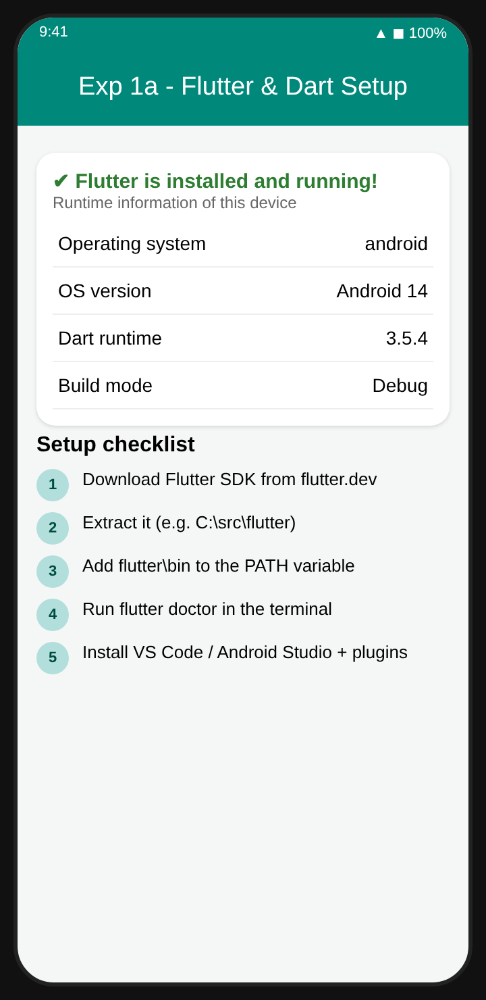</p>

**Procedure:**
1. Download the latest Flutter SDK zip package from the official website (flutter.dev).
2. Extract the archive to a desired path (e.g., C:\src\flutter).
3. Add the Flutter bin directory to the system PATH environment variable.
4. Open the command terminal and execute flutter doctor to verify installed dependencies and setup requirements.
5. Install VS Code or Android Studio along with Flutter and Dart extensions.

**Implemented in:** `lib/experiments/exp01_setup.dart`  
**Main class(es):** `Exp1aSetupScreen`  
**How to open it in the app:** Lab tab -> Exp 1a

**Result:** Flutter and Dart SDK were successfully installed and configured.

---

## Experiment 1b
### Dart Language Basics

**Aim:** To write and execute a simple Dart program demonstrating basic programming concepts (variables, data types, control flow, functions).

<p align="center">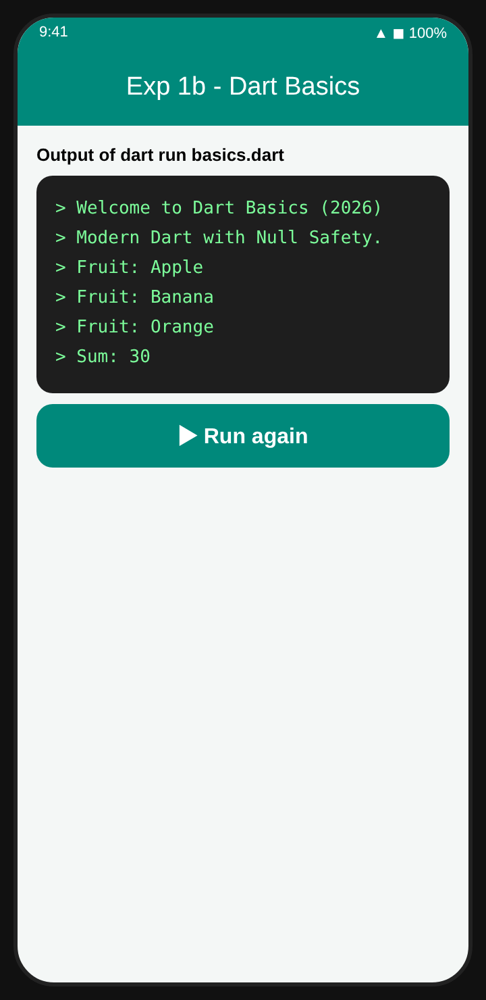</p>

**Procedure:**
1. Open DartPad or create a file named basics.dart.
2. Write a Dart program demonstrating variables, conditional statements, loops, and functions.
3. Run the program using dart run basics.dart.

**Implemented in:** `lib/experiments/exp01_setup.dart  +  dart_basics/basics.dart`  
**Main class(es):** `Exp1bDartBasicsScreen`  
**How to open it in the app:** Lab tab -> Exp 1b

**Result:** Basic Dart syntax and control flow were implemented and verified.

---

## Experiment 2a
### Exploration of Basic Flutter Widgets

**Aim:** To explore core structural and presentational widgets in Flutter (Text, Image, Container, Scaffold).

<p align="center">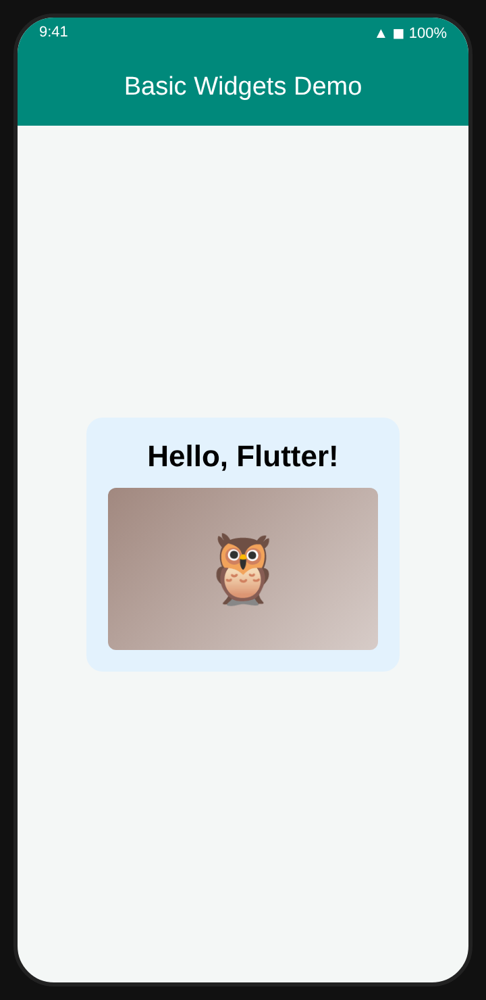</p>

**Procedure:**
1. Create a new Flutter project: flutter create exp2a.
2. Modify lib/main.dart to include Scaffold, Container, Text, and Image widgets.
3. Run the project using flutter run.

**Implemented in:** `lib/experiments/exp02_widgets.dart`  
**Main class(es):** `Exp2aBasicWidgetsScreen`  
**How to open it in the app:** Lab tab -> Exp 2a

**Result:** Basic Flutter widgets were successfully displayed on screen.

---

## Experiment 2b
### Layout Structures using Row, Column, and Stack

**Aim:** To construct flexible layout layouts using Row, Column, and Stack widgets.

<p align="center">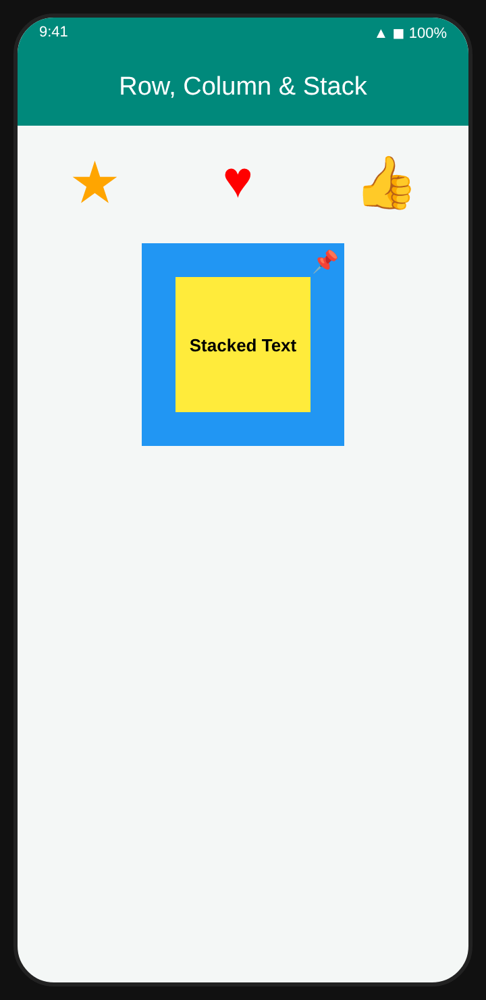</p>

**Procedure:**
1. Create a Flutter app with Row, Column, and Stack structures.
2. Nest widgets inside Row and Column and overlay widgets inside Stack.
3. Test layout output on an emulator.

**Implemented in:** `lib/experiments/exp02_widgets.dart`  
**Main class(es):** `Exp2bLayoutScreen`  
**How to open it in the app:** Lab tab -> Exp 2b

**Result:** Layout structures using Row, Column, and Stack were implemented successfully.

---

## Experiment 3a
### Responsive UI Design

**Aim:** To build a responsive user interface that adapts dynamically to diverse viewport sizes.

<p align="center">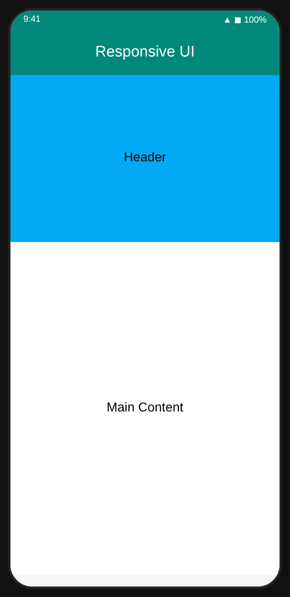</p>

**Procedure:**
1. Use LayoutBuilder to inspect parent constraints.
2. Conditionally render desktop or mobile layouts based on maximum width thresholds.

**Implemented in:** `lib/experiments/exp03_responsive.dart  +  lib/screens/home_screen.dart (responsive document grid)`  
**Main class(es):** `Exp3aResponsiveScreen`  
**How to open it in the app:** Lab tab -> Exp 3a

**Result:** The application UI adapts dynamically according to screen dimensions.

---

## Experiment 3b
### Media Queries and Breakpoints for Responsiveness

**Aim:** To implement Media Queries to extract device metrics and apply structural breakpoints.

<p align="center">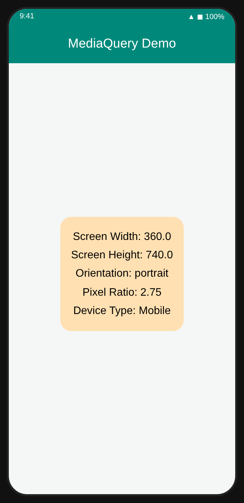</p>

**Procedure:**
1. Access MediaQuery.of(context).size to fetch device dimensions.
2. Define custom width thresholds (e.g., 600px breakpoint).
3. Display screen metrics and toggle UI properties dynamically.

**Implemented in:** `lib/experiments/exp03_responsive.dart`  
**Main class(es):** `Exp3bMediaQueryScreen`  
**How to open it in the app:** Lab tab -> Exp 3b (rotate the phone!)

**Result:** Media queries and layout breakpoints were successfully integrated.

---

## Experiment 4a
### Basic Navigation Using Navigator

**Aim:** To implement basic screen navigation and data passing using Flutter's Navigator.

<p align="center">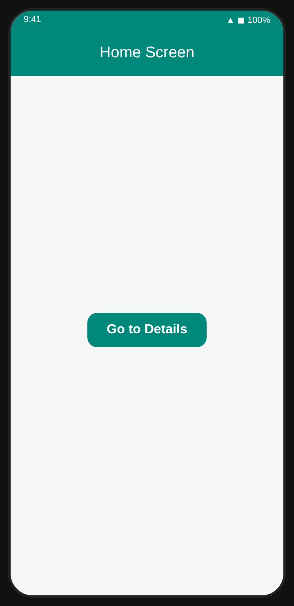</p>

<p align="center">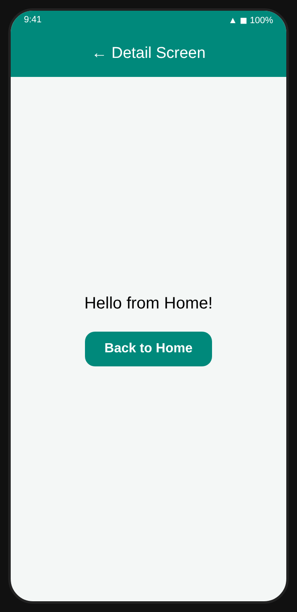</p>

**Procedure:**
1. Define two StatelessWidget screens (HomeScreen and DetailScreen).
2. Implement Navigator.push() on button press to navigate forward.
3. Implement Navigator.pop() to navigate back.

**Implemented in:** `lib/experiments/exp04_navigation.dart  +  lib/screens/home_screen.dart -> document_detail_screen.dart`  
**Main class(es):** `Exp4aHomeScreen / Exp4aDetailScreen`  
**How to open it in the app:** Lab tab -> Exp 4a, or tap any document

**Result:** Navigation between two screens using Navigator.push and Navigator.pop was achieved.

---

## Experiment 4b
### Navigation with Named Routes

**Aim:** To set up named routes for route abstraction and centralized navigation management.

<p align="center">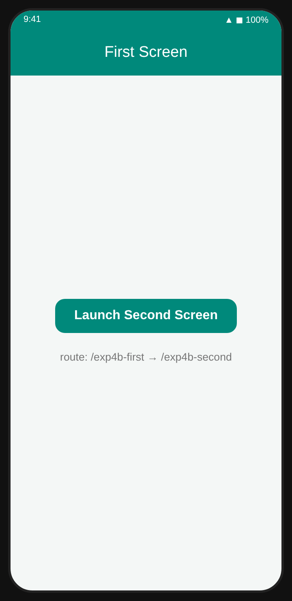</p>

**Procedure:**
1. Configure initialRoute and routes map in MaterialApp.
2. Navigate using Navigator.pushNamed(context, '/routeName').

**Implemented in:** `lib/main.dart (routes table)  +  lib/experiments/exp04_navigation.dart`  
**Main class(es):** `Exp4bFirstScreen / Exp4bSecondScreen`  
**How to open it in the app:** Lab tab -> Exp 4b, or the Scan button (/scan)

**Result:** Named routes navigation was successfully configured and verified.

---

## Experiment 5a
### Stateful vs Stateless Widgets

**Aim:** To understand and implement stateful and stateless widget lifecycles.

<p align="center">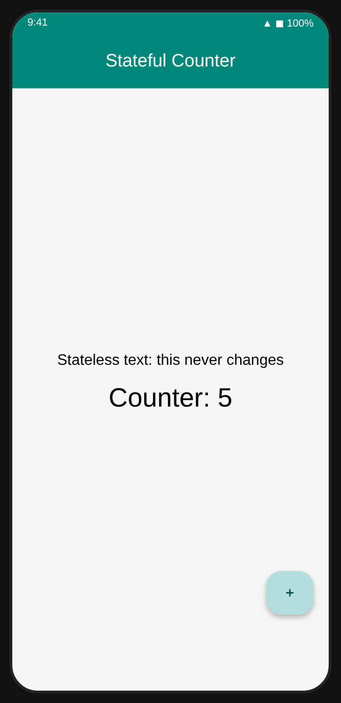</p>

**Procedure:**
1. Create a counter application using a StatefulWidget.
2. Mutate state variable within setState() method to trigger UI re-build.

**Implemented in:** `lib/experiments/exp05_state.dart`  
**Main class(es):** `Exp5aCounterScreen`  
**How to open it in the app:** Lab tab -> Exp 5a

**Result:** State modification using setState() in a StatefulWidget was implemented.

---

## Experiment 5b
### State Management using Provider

**Aim:** To implement app-wide state management using the Provider package.

<p align="center">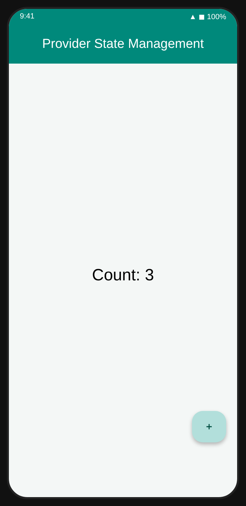</p>

**Procedure:**
1. Add provider: dependency to pubspec.yaml.
2. Create a class extending ChangeNotifier.
3. Wrap app root with ChangeNotifierProvider and consume state via context.watch / Provider.of.

**Implemented in:** `lib/app_state.dart  +  lib/experiments/exp05_state.dart`  
**Main class(es):** `AppState / CounterModel`  
**How to open it in the app:** Whole app: documents, stats and theme come from Provider

**Result:** Global state management using the Provider package was successfully implemented.

---

## Experiment 6a
### Creation of Custom Widgets

**Aim:** To design reusable custom UI widgets to reduce redundancy.

<p align="center">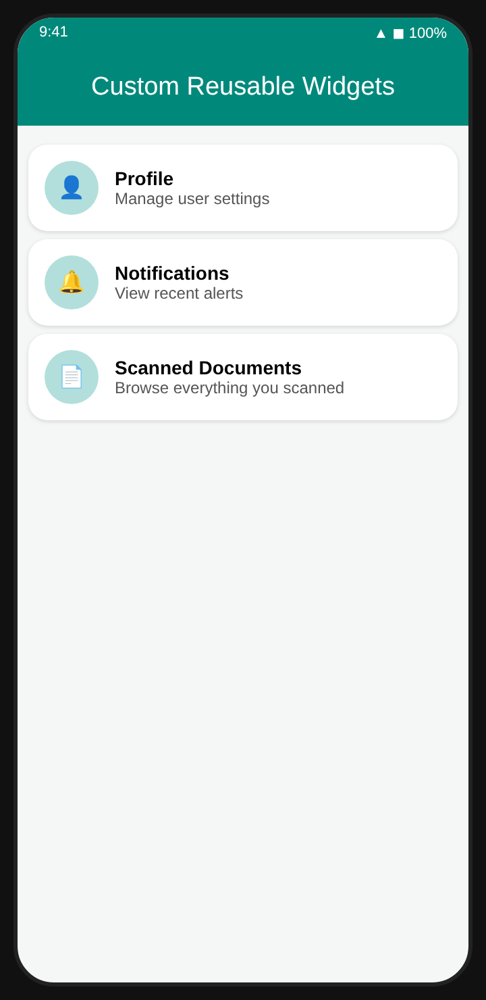</p>

**Procedure:**
1. Define a custom widget class CustomCardTile accepting title, subtitle, and icon parameters.
2. Instantiate CustomCardTile multiple times in the main view.

**Implemented in:** `lib/widgets/custom_widgets.dart  +  lib/experiments/exp06_custom_theme.dart`  
**Main class(es):** `CustomCardTile, StatCard, GradientHeader`  
**How to open it in the app:** Settings tab, Home header, Lab -> Exp 6a

**Result:** Custom reusable UI components were created and integrated.

---

## Experiment 6b
### Styling using Themes and Custom Styles

**Aim:** To apply dynamic app-wide themes (ThemeData) and inline styles.

<p align="center">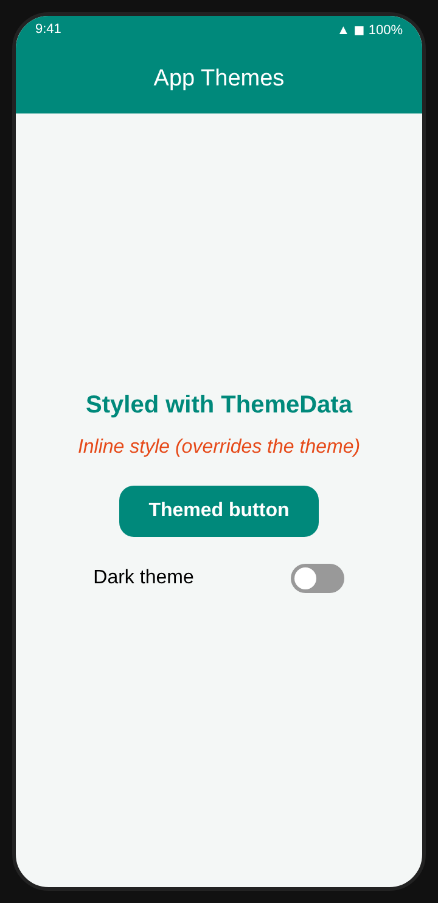</p>

**Procedure:**
1. Define custom ThemeData inside MaterialApp.
2. Apply theme colors dynamically using Theme.of(context).

**Implemented in:** `lib/theme.dart  +  lib/experiments/exp06_custom_theme.dart`  
**Main class(es):** `AppTheme.build()`  
**How to open it in the app:** Settings tab -> Dark mode + accent colour

**Result:** Global application themes and custom styles were successfully configured.

---

## Experiment 7a
### Designing Forms with Various Input Fields

**Aim:** To design a user registration form using input controls (TextFormField, Checkbox, Switch).

<p align="center">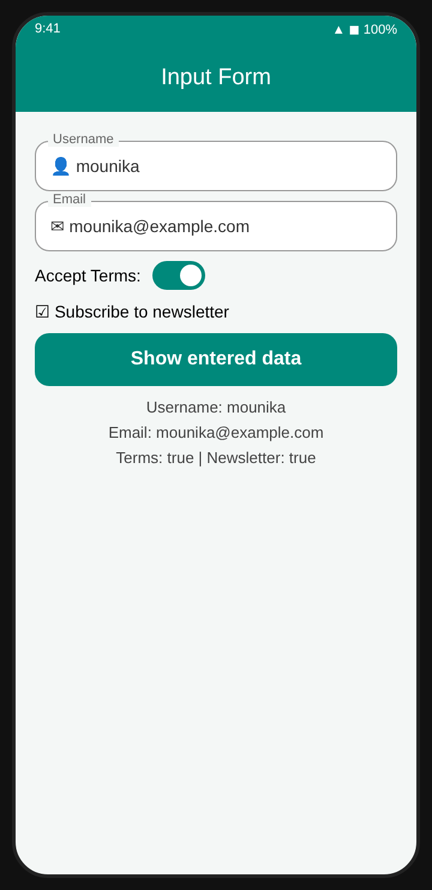</p>

**Procedure:**
1. Create a Form widget containing TextFormField, Switch, and ElevatedButton.
2. Manage input state using controllers.

**Implemented in:** `lib/screens/scan_screen.dart  +  lib/experiments/exp07_forms.dart`  
**Main class(es):** `Exp7aFormScreen`  
**How to open it in the app:** Scan screen (title, chips, switch, checkbox) / Lab -> Exp 7a

**Result:** Input forms containing diverse field controls were created successfully.

---

## Experiment 7b
### Form Validation and Error Handling

**Aim:** To implement input validation and error prompts within a Flutter form.

<p align="center">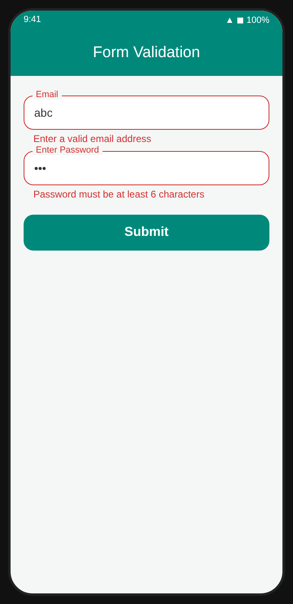</p>

**Procedure:**
1. Assign GlobalKey<FormState> to the Form widget.
2. Implement validation checks inside validator parameter.
3. Trigger _formKey.currentState!.validate() on button click.

**Implemented in:** `lib/screens/scan_screen.dart  +  lib/experiments/exp07_forms.dart`  
**Main class(es):** `Exp7bValidationScreen`  
**How to open it in the app:** Scan screen: press Save with empty fields / Lab -> Exp 7b

**Result:** Form validation logic and error feedback were verified.

---

## Experiment 8a
### UI Animations using Flutter Animation Framework

**Aim:** To create explicit animations using AnimationController and Tween.

<p align="center">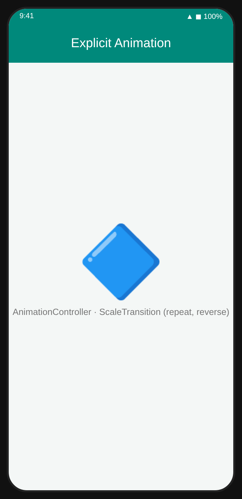</p>

**Procedure:**
1. Mix SingleTickerProviderStateMixin into state class.
2. Instantiate AnimationController and set animation duration.
3. Use ScaleTransition or RotationTransition bound to controller.

**Implemented in:** `lib/screens/splash_screen.dart  +  lib/experiments/exp08_animation.dart`  
**Main class(es):** `SplashScreen / Exp8aAnimationScreen`  
**How to open it in the app:** App start-up splash / Lab -> Exp 8a

**Result:** Explicit scale animation was built using AnimationController.

---

## Experiment 8b
### Implicit Animations (Fade and Slide Animations)

**Aim:** To experiment with implicit animation widgets such as AnimatedOpacity and AnimatedContainer.

<p align="center">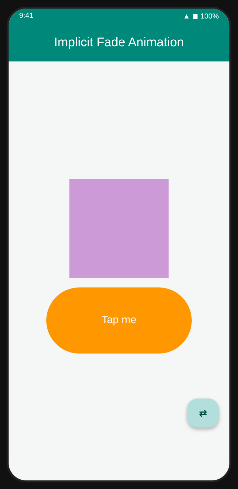</p>

**Procedure:**
1. Define a state flag (e.g. _visible = true).
2. Wrap child in AnimatedOpacity.
3. Toggle flag inside setState() to animate transition dynamically.

**Implemented in:** `lib/widgets/custom_widgets.dart (count-up), scan_screen.dart (step bar)  +  lib/experiments/exp08_animation.dart`  
**Main class(es):** `Exp8bImplicitScreen`  
**How to open it in the app:** Home stats count up, Scan step bar / Lab -> Exp 8b

**Result:** Fade transitions using AnimatedOpacity were executed successfully.

---

## Experiment 9a
### Fetching Data from REST API

**Aim:** To fetch external JSON network data asynchronously using the http package.

<p align="center">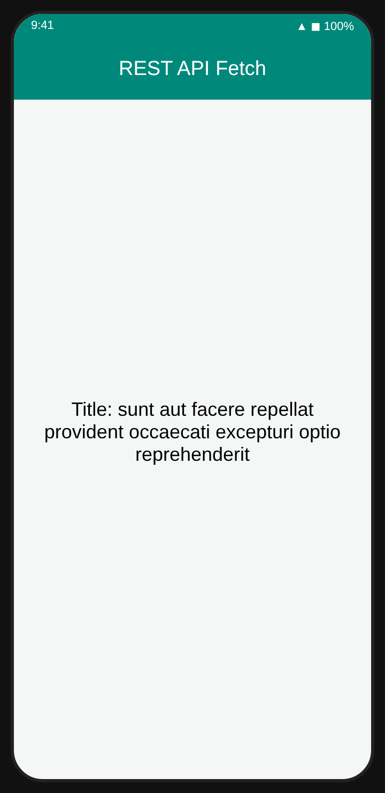</p>

**Procedure:**
1. Import package:http/http.dart.
2. Define an asynchronous method executing http.get(Uri.parse(url)).
3. Parse returned raw JSON payload using jsonDecode.

**Implemented in:** `lib/screens/tips_screen.dart  +  lib/experiments/exp09_api.dart`  
**Main class(es):** `Exp9aFetchScreen`  
**How to open it in the app:** Lab -> Exp 9a

**Result:** REST API data fetching was successfully performed asynchronously.

---

## Experiment 9b
### Displaying Fetched API Data in UI

**Aim:** To parse dynamic JSON lists from REST endpoints and render them within a ListView.builder.

<p align="center">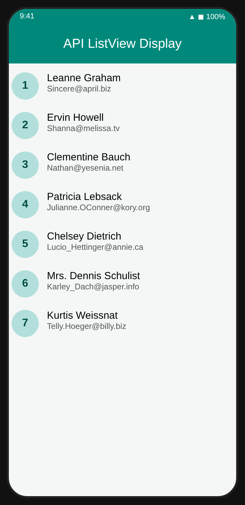</p>

**Procedure:**
1. Execute an API request returning a list of objects.
2. Bind snapshot list output directly inside ListView.builder.

**Implemented in:** `lib/screens/tips_screen.dart  +  lib/experiments/exp09_api.dart`  
**Main class(es):** `Exp9bListScreen`  
**How to open it in the app:** Tips tab (ListView.builder) / Lab -> Exp 9b

**Result:** Parsed API records were successfully displayed in a structured ListView.

---

## Experiment 10a
### Writing Unit and Widget Tests

**Aim:** To write automated unit/widget tests for Flutter UI components using flutter_test.

<p align="center">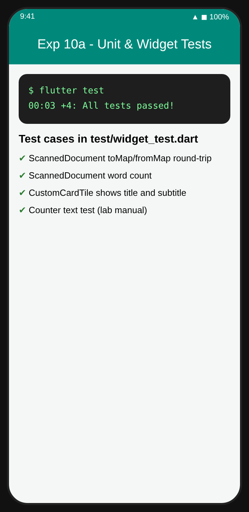</p>

**Procedure:**
1. Open or create test/widget_test.dart.
2. Use WidgetTester to pump widgets and search using findsOneWidget.
3. Run test in terminal: flutter test.

**Implemented in:** `test/widget_test.dart`  
**Main class(es):** `4 unit + widget tests`  
**How to open it in the app:** Terminal: flutter test

**Result:** Widget unit test was created and passed successfully.

---

## Experiment 10b
### Flutter Debugging Tools

**Aim:** To debug Flutter applications using DevTools, Inspector, and standard logging tools.

<p align="center">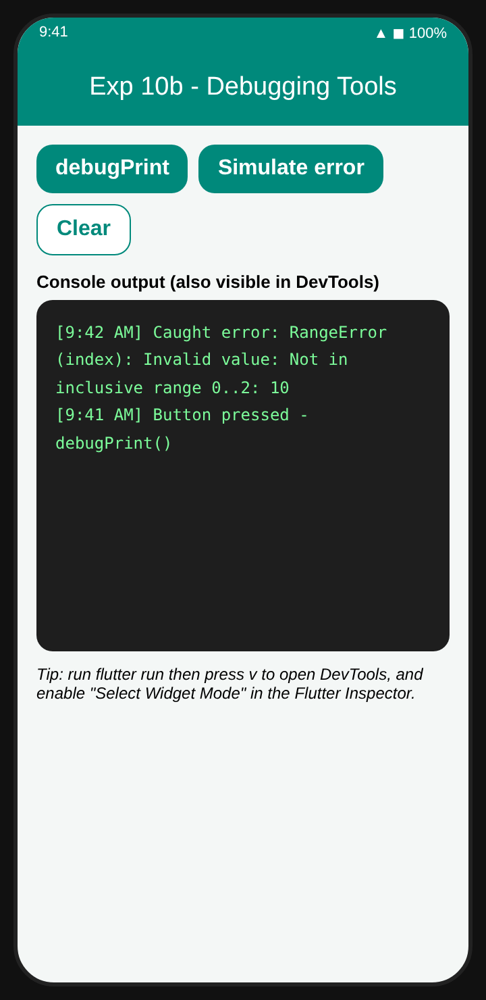</p>

**Procedure:**
1. Run application in debug mode: flutter run.
2. Open Flutter DevTools by pressing v in terminal or clicking "Open DevTools" in VS Code.
3. Enable "Toggle Select Widget Mode" in Flutter Inspector to diagnose layout boundaries and overflow issues.
4. Inspect console outputs generated via debugPrint().

**Implemented in:** `lib/experiments/exp10_testing_debugging.dart`  
**Main class(es):** `Exp10bDebugScreen`  
**How to open it in the app:** Settings -> Debug console / Lab -> Exp 10b

**Result:** Flutter DevTools and visual inspection tools were successfully used to debug application layouts and logs.

---

## Technologies Used
Flutter - Dart - Provider - sqflite (SQLite) - google_mlkit_text_recognition - image_picker - pdf - share_plus - http - flutter_test

## Viva Talking Points
- **OCR** runs on-device with Google ML Kit - no internet, no data leaves the phone.
- **SQLite** (`sqflite`) stores documents in table `documents` (id, title, imagePath, extractedText, createdAt, category, favorite).
- **Provider** (`AppState extends ChangeNotifier`) shares documents and theme across all screens - Exp 5b.
- **Layers:** models (data) / services (DB, OCR, PDF) / screens (UI) - separation of concerns.
- **PDF** is generated natively in Dart with the `pdf` package and shared with `share_plus`.
- **Responsive:** the document grid uses `SliverGridDelegateWithMaxCrossAxisExtent`, so it shows 1 column on phones and more on tablets.

## Possible Future Enhancements
Edge detection & perspective crop - multi-page PDF - cloud backup (Firebase) - handwriting recognition.
